## Table of Contents

1. [Introduction & System Overview](#1-introduction--system-overview)
2. [Technology Stack](#2-technology-stack)
3. [System Architecture](#3-system-architecture)
4. [Use Case Diagram](#4-use-case-diagram)
5. [Data Flow Diagrams](#5-data-flow-diagrams)
6. [Entity Relationship Diagram (Database Schema)](#6-entity-relationship-diagram-database-schema)
7. [Class Diagram (Domain Model)](#7-class-diagram-domain-model)
8. [State Chart Diagrams](#8-state-chart-diagrams)
9. [Sequence Diagrams](#9-sequence-diagrams)
10. [Communication Diagram — Sale Processing](#10-communication-diagram--sale-processing)
11. [Activity Diagram — Sale & Inventory Update Flow](#11-activity-diagram--sale--inventory-update-flow)
12. [Access Control (RBAC) Model](#12-access-control-rbac-model)
13. [Appendix A — Convex Backend Module Reference](#13-appendix-a--convex-backend-module-reference)
14. [Appendix B — Glossary](#14-appendix-b--glossary)

---

## 1. Introduction & System Overview

**MansaStock** is a multi-tenant Point-of-Sale (POS) and inventory-management SaaS platform for small and medium retail businesses. Each customer business operates as an isolated **organization** (tenant), with role-based staff accounts, a product catalog, a POS checkout terminal, sales/refund history, low-stock alerting, and a public QR-code ordering storefront for their own customers.

The system is delivered through **three client surfaces sharing one backend**:

| Surface | Technology | Purpose |
|---|---|---|
| Web application | Next.js (App Router) | Full admin/manager/cashier dashboard + browser-based POS terminal |
| Android TWA shell | Bubblewrap-wrapped web app | Installs the web POS as a Play Store app with no browser chrome (thin wrapper, no separate business logic) |
| Native mobile app | Expo / React Native (iOS + Android) | Full native POS with offline-first sales queueing, camera/HID barcode scanning, and receipt printing |
| Public storefront | Next.js public route (`/order/[storeSlug]`) | Unauthenticated customer-facing QR ordering menu |

All four surfaces read and write the **same Convex backend deployment** — there is one database, one set of business rules, and one authorization model shared across web, TWA, and native mobile.

---

## 2. Technology Stack

### 2.1 Web Application (`mansa-stock`)

| Layer | Technology | Notes |
|---|---|---|
| Framework | **Next.js 16** (React 19), App Router | Route groups: `app/(app)/` (authenticated dashboard), `app/(pos)/` (POS terminal), `app/order/` (public storefront) |
| Language | TypeScript 5 | Strict typing across frontend and Convex functions |
| Backend-as-a-Service | **Convex 1.31** | Reactive database + serverless functions (queries/mutations/actions), shared with the mobile app |
| Authentication | **Clerk** (`@clerk/nextjs`, Clerk Organizations) | Multi-tenant identity provider; one Clerk Organization ≈ one MansaStock business |
| Styling | Tailwind CSS 4, Radix UI / Base UI primitives, shadcn-generated components | `class-variance-authority`, `lucide-react` icons, `cmdk` command palette, `sonner` toasts |
| Animation | `motion` (Framer Motion's successor), GSAP | Page/section transitions, POS cart animations |
| Data tables & charts | `@tanstack/react-table`, `recharts` | Inventory/sales tables, dashboard analytics |
| Barcode scanning | `@zxing/browser`, native `BarcodeDetector` API (feature-detected) | Camera-based scan in POS and inventory forms; falls back to zxing on unsupported browsers |
| Voice input | Web Speech API (`SpeechRecognition`) | Dictation in the AI assistant composer |
| Spreadsheet I/O | `xlsx` | Bulk product import, report export |
| Image handling | `browser-image-compression`, `heic2any` | Client-side compression + iPhone HEIC→JPEG conversion before upload |
| QR codes | `qrcode` | Generates the storefront's ordering QR code |
| AI assistant | `streamdown` (streaming markdown) | Conversational analytics assistant panel |
| Observability | `posthog-js`, `@posthog/nextjs-config`, `@vercel/analytics`, `@vercel/speed-insights` | See §2.6 |

### 2.2 Mobile Application (`MansaStock-Mobile`)

| Layer | Technology | Notes |
|---|---|---|
| Framework | **Expo SDK 54**, React Native 0.81, React 19 | `expo-router` file-based navigation; route groups `(auth)/` and `(pos)/(tabs)/` |
| Language | TypeScript | Shared conventions with the web repo |
| Backend | **Convex 1.35** JS client | Generated client (`convex/_generated/`) mirrors the *same* deployment as the web app — no separate functions live in the mobile repo |
| Authentication | `@clerk/expo` + `expo-secure-store` token cache, `ConvexProviderWithClerk` | Identical Clerk org/JWT model as web, wired directly into the Convex React client |
| Styling | `nativewind` (Tailwind-in-React-Native), Tailwind CSS 4 | Mirrors the web app's design tokens |
| Animation/gestures | `react-native-reanimated`, `react-native-gesture-handler` | Swipe/cart interactions |
| Offline persistence | `@react-native-async-storage/async-storage`, `@react-native-community/netinfo` | Custom offline-first layers: `offline-sales-storage.ts`, `active-cart-storage.ts`, `held-sales-storage.ts` — sales made while offline are queued and synced with an idempotent `clientSaleId` |
| Camera / hardware | `expo-camera` (barcode/QR scanning), `expo-print` (receipts), `expo-notifications` + Firebase (native push) | |
| Biometrics | `expo-local-authentication` | Device app-lock |
| Build/deploy | **EAS Build** (`development`/`preview`/`production` profiles), native `android/` Gradle project | Genuine native app via Expo/EAS — **not** a TWA wrapper (that's the separate web-based distribution channel) |

### 2.3 Backend-as-a-Service: Convex

Convex provides the entire backend: a reactive document database, serverless TypeScript functions (`query` / `mutation` / `action`), file storage, and cron scheduling — all in one deployment shared by both client apps. Key architectural facts:

- **24 tables**, almost every one indexed on `organizationId` (multi-tenant partition key) — see §6.
- Functions are organized into **domain modules** (`products.ts`, `sales.ts`, `access.ts`, `rbac.ts`, `dashboard.ts`, …) — see Appendix A.
- **No decorator-based auth** — every query/mutation calls `requireOrganizationMembership()` or `requirePermission()` as the first line of its handler (see §12).
- Reactive queries mean the UI subscribes to live data; when a mutation writes, every open subscription that reads the affected rows re-renders automatically (both on web and mobile) — no manual polling/refetching.

### 2.4 Authentication & Multi-Tenancy

- **Clerk Organizations** model tenants: one Clerk Organization = one MansaStock business. A user can belong to multiple organizations (multi-store staff).
- **Web edge middleware** (`proxy.ts`, Next.js 16's renamed `middleware.ts`) wraps `clerkMiddleware`; only `/`, `/login`, `/signup`, `/accept-invitation`, `/order` (public storefront), and `/contact` are unauthenticated — everything else calls `auth.protect()`.
- **Convex identity mapping** (`convex/auth.config.ts`) registers Clerk as the JWT issuer, so `ctx.auth.getUserIdentity()` inside any Convex function returns the decoded Clerk claims (user id, active org id/role).
- **Clerk → Convex sync**: a Clerk webhook (`app/api/webhooks/clerk/route.ts`) pushes org-membership/role changes into Convex's own `userRoles`/`pendingUserInvites` tables via a secret-guarded server-to-server call — Convex's RBAC tables, not the live Clerk role, are the durable source of truth for authorization (see §12).
- **Mobile** uses the identical Clerk session model via `@clerk/expo`, feeding the same Convex backend — one identity graph, two clients.

### 2.5 Deployment & Infrastructure

- **Web hosting**: **Vercel** (Next.js-native hosting + edge middleware).
- **CI/CD** (`.github/workflows/ci.yml`): (1) lint + typecheck on every PR, (2) `npx convex deploy` on merge to `main` (Convex backend deploys are driven by CI, independent of Vercel's build step), (3) automatic GitHub release tagging.
- **Android TWA**: the web POS is packaged via **Bubblewrap** as a Trusted Web Activity, launching directly into `/pos`, distributed through Google Play under package id `com.mansastock.pos`. Requires `/manifest.webmanifest` and `/.well-known/assetlinks.json` (Digital Asset Links) served from production so Chrome removes browser chrome. This is a thin wrapper with **no duplicated business logic** — a second distribution channel for the same web app, distinct from the native mobile app below.
- **Native mobile distribution**: **EAS Build/Submit** produces store binaries for Google Play and the Apple App Store from the Expo/React Native codebase.
- **Push notifications**: Convex actions call the **Expo Push Service**, which relays to **Firebase Cloud Messaging** for Android delivery.

### 2.6 Observability & Analytics

- **PostHog** is the sole analytics/error-tracking pipeline (no separate Sentry integration found in code).
  - **Client** (`posthog-js`): initialized with `api_host: "/ingest"` — never calls PostHog's domain directly. `next.config.ts` rewrites `/ingest/*` to PostHog's ingestion hosts, defeating ad-blockers and keeping analytics traffic out of Clerk's auth matcher.
  - **Identity**: `distinctId` = the Clerk user id, set via `posthog.identify()` on sign-in and reset on sign-out.
  - **Server-side** (`@posthog/convex` component, registered in `convex.config.ts`): Convex mutations/actions call `reportException()` from `convex/posthog.ts` inside `catch` blocks to forward exceptions to PostHog Error Tracking without ever throwing itself.
  - **Source maps**: `withPostHogConfig` uploads build-time source maps tagged with the Vercel git commit SHA, so production stack traces de-minify to real source.
  - Session replay is enabled with `maskAllInputs: true`.
- The **mobile app has no PostHog/analytics dependency** — observability is currently web-only (a noted gap for future work).
- `@vercel/analytics` / `@vercel/speed-insights` provide Vercel's own pageview and Core Web Vitals beacons.

---

## 3. System Architecture

### 3.1 High-Level Architecture

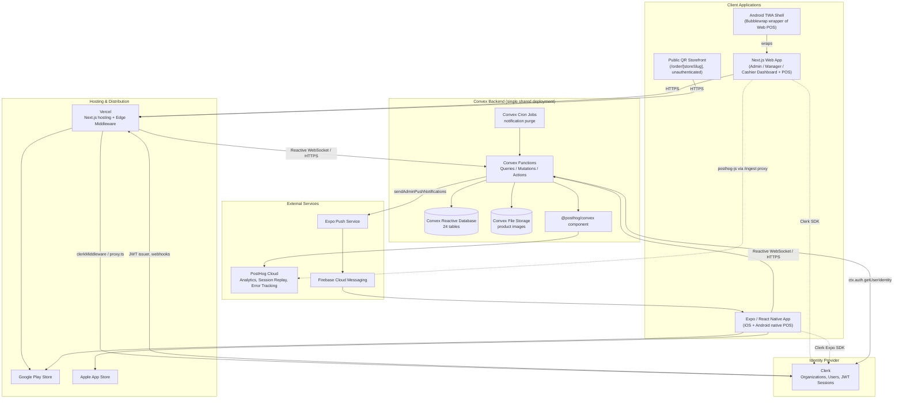

### 3.2 Deployment Diagram (Runtime / Physical View)

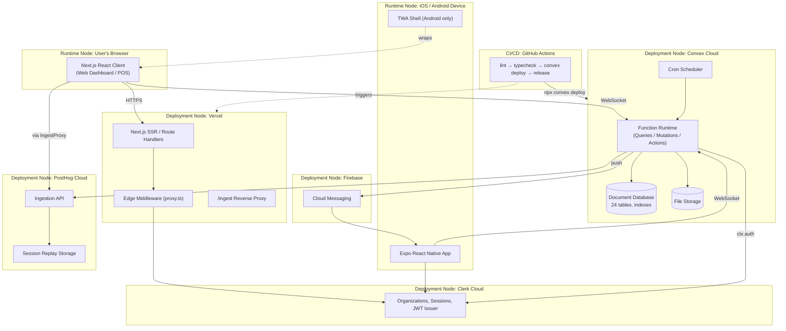

### 3.3 Component Diagram

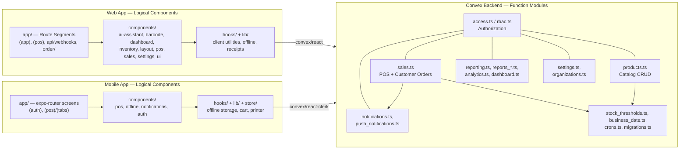

---

## 4. Use Case Diagram

> Mermaid has no native use-case diagram type; actors are drawn as stadium nodes and use cases as circle/oval nodes inside a system-boundary subgraph — the standard textual workaround.

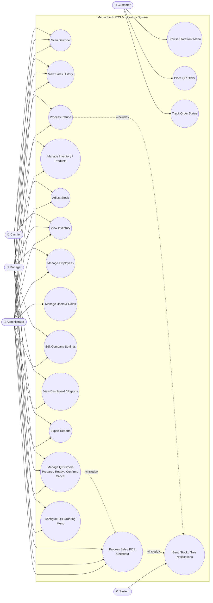

### Use Case Descriptions

| Use Case | Primary Actor | Preconditions | Trigger | Postcondition |
|---|---|---|---|---|
| Process Sale / POS Checkout | Cashier, Manager, Administrator | Has `sales_create`; cart non-empty | Tap "Finalize Sale" | Sale recorded, stock decremented, receipt issued |
| Scan Barcode | Cashier, Manager, Administrator | Camera or HID scanner available | Scan a product code | Matched product added to cart / SKU field filled |
| View Sales History | Cashier, Manager, Administrator | Has `sales_view` | Open Sales page | List of past transactions displayed |
| Process Refund | Manager, Administrator | Has `sales_refund`; sale not already fully refunded | Select sale, choose lines/quantities | Refund recorded, stock restored, sale status updated |
| Manage Inventory / Products | Manager, Administrator | Has `inventory_manage` | Add/edit/import product | Product catalog updated |
| Adjust Stock | Manager, Administrator | Has `inventory_adjust` | Manual stock correction | `products.stock` patched |
| View Inventory | All staff roles | Has `inventory_view` | Open Inventory page | Catalog with stock levels displayed |
| Manage Employees | Manager, Administrator | Has `employees_manage` | Invite/edit staff member | `userRoles` / `pendingUserInvites` updated |
| Manage Users & Roles | Administrator only | Has `settings_users` | Edit role-permission matrix | `rolePermissions` updated |
| Edit Company Settings | Manager, Administrator | Has `settings_company` | Update business profile | `companySettings` updated |
| View Dashboard / Reports | Manager, Administrator | Has `reports_view` | Open Dashboard/Reports page | Analytics rendered |
| Export Reports | Manager, Administrator | Has `reports_export` | Click export | CSV/PDF generated |
| Manage QR Orders | Cashier, Manager, Administrator | Has `sales_create` | Order arrives / staff acts on it | Order status transitions (see §8.3) |
| Configure QR Ordering Menu | Manager, Administrator | Has `sales_create` + `settings_company` (feature toggle) | Generate/enable menu | `customerOrderMenus` created/enabled |
| Browse Storefront Menu | Customer | Menu enabled | Scan store QR code | Product menu displayed |
| Place QR Order | Customer | Menu enabled, products in stock | Submit cart + contact info | `customerOrders` created (status `pending`) |
| Track Order Status | Customer | Has order number/link | Open tracking link | Live order status displayed |
| Send Stock / Sale Notifications | System | Sale/refund crosses a threshold | Stock decrement/increment or sale event | Admin notification created + optional push |

---

## 5. Data Flow Diagrams

### 5.1 Context Diagram (Level 0)

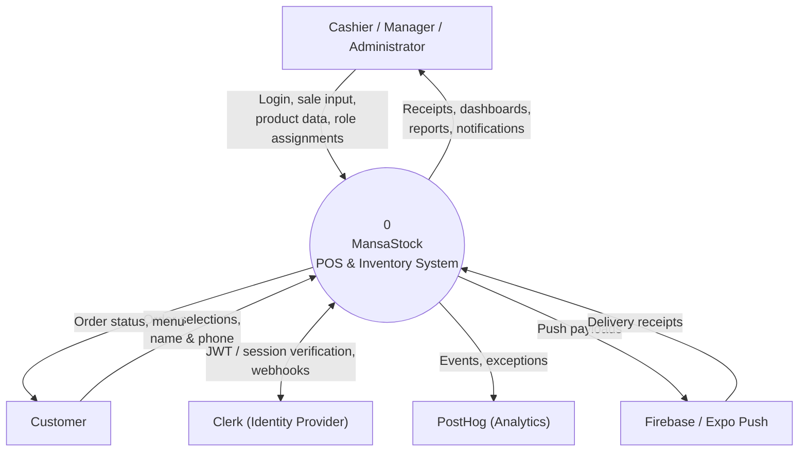

### 5.2 Level 1 Data Flow Diagram

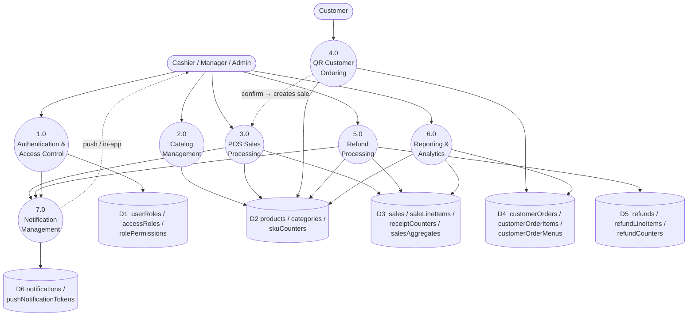

---

## 6. Entity Relationship Diagram (Database Schema)

The Convex schema (`convex/schema.ts`) defines **24 tables**. Almost every table carries an `organizationId: string` field (the multi-tenant partition key) indexed as the first component of its primary index — this is the dominant relationship across the whole schema and is called out once here rather than repeated on every cluster diagram below. There is **no `users` table**: identity lives entirely in Clerk; only role/preference/token *projections* are stored locally (`userRoles`, `personalSettings`, `pushNotificationTokens`).

Convex references (`v.id("otherTable")`) are the closest equivalent to a foreign key and are shown as solid relationship lines below. Several relationships are **logical only** (matched by string/enum value, not `v.id()`) — e.g. `organizations.organizationId` to every tenant-scoped table, `rolePermissions.roleId` ↔ `accessRoles.roleId`, and `customerOrders.menuSlug` ↔ `customerOrderMenus.slug`. These are noted in prose rather than drawn as `v.id()` edges, to keep the diagrams accurate to the type system.

The ER diagram is split into four domain clusters for readability, followed by a complete field-by-field reference (§6.5).

### 6.1 Cluster A — Organization, Identity & Access Control

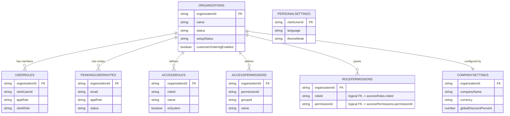

`PERSONALSETTINGS` is deliberately not linked to `ORGANIZATIONS` — it is the **only** table with no `organizationId`, keyed solely by `clerkUserId` (per-user, cross-org preferences).

### 6.2 Cluster B — Catalog & Inventory

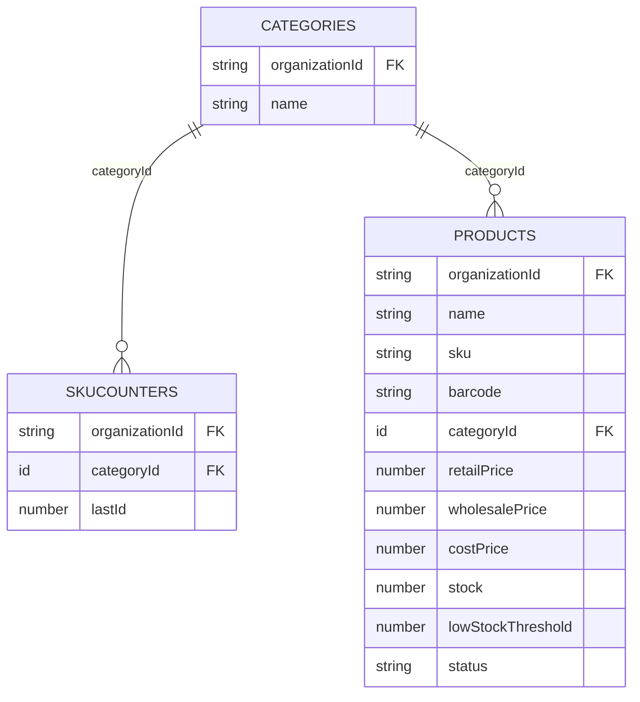

### 6.3 Cluster C — Sales & Refunds

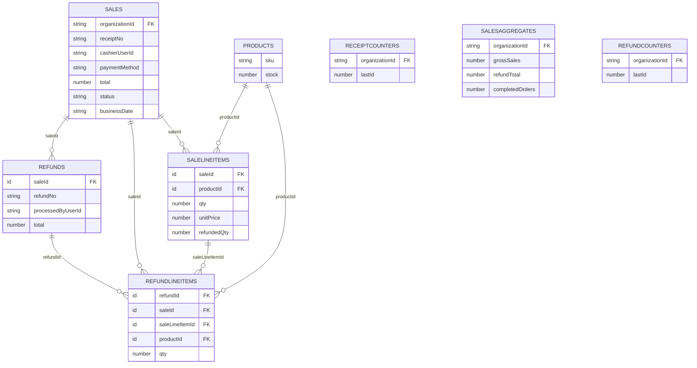

### 6.4 Cluster D — Customer Ordering & Notifications

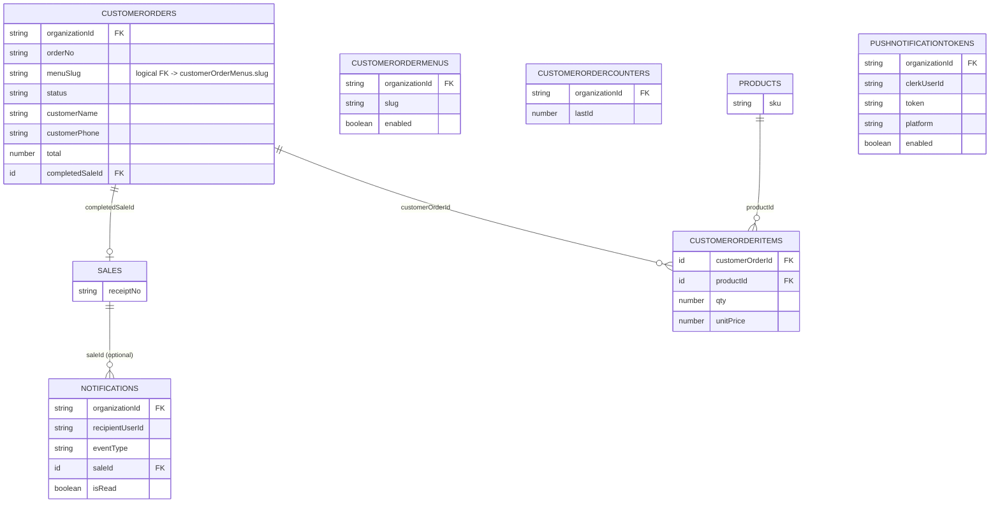

### 6.5 Full Schema Reference

<details>
<summary><strong>Click to expand the complete field-by-field schema (all 24 tables)</strong></summary>

#### organizations
| Field | Type | Notes |
|---|---|---|
| organizationId | string | Clerk org id (not a Convex `v.id`) |
| name | string | |
| slug | string? | |
| imageUrl | string? | |
| status | `"active"｜"inactive"｜"deleted"` | |
| setupStatus | `"new"｜"company_ready"｜"catalog_ready"｜"pos_ready"` | Onboarding progress |
| hasCompanySettings / hasProducts / hasAccessSeeded | boolean | Onboarding flags |
| customerOrderingEnabled | boolean | |
| businessType | string? | |
| onboardingCompletedAt | number? | |
| createdAt / updatedAt / deletedAt | number / number / number? | |

Indexes: `by_organizationId`, `by_status`, `by_setupStatus`, `by_updatedAt`

#### userRoles
| Field | Type |
|---|---|
| organizationId | string |
| clerkUserId | string |
| appRole | `"administrator"｜"manager"｜"cashier"` |
| clerkRole | string |
| email / name | string? |
| updatedAt | number |

Indexes: `by_organizationId`, `by_organizationId_and_clerkUserId`, `by_organizationId_and_appRole`

#### pendingUserInvites
| Field | Type |
|---|---|
| organizationId | string |
| email | string |
| appRole | `"administrator"｜"manager"｜"cashier"` |
| clerkRole | string |
| invitationId / status | string? |
| invitedAt / updatedAt | number |

Indexes: `by_organizationId`, `by_organizationId_and_email`

#### accessRoles
| Field | Type |
|---|---|
| organizationId | string |
| roleId | `"administrator"｜"manager"｜"cashier"` |
| name | string |
| isSystem | boolean |
| createdAt | number |

Indexes: `by_organizationId`, `by_organizationId_and_roleId`

#### accessPermissions
| Field | Type |
|---|---|
| organizationId | string |
| permissionId | string |
| groupId / groupLabel | string |
| name / description | string |
| createdAt | number |

Indexes: `by_organizationId`, `by_organizationId_and_permissionId`, `by_organizationId_and_groupId`

#### rolePermissions
| Field | Type |
|---|---|
| organizationId | string |
| roleId | `"administrator"｜"manager"｜"cashier"` |
| permissionId | string |
| createdAt | number |

Indexes: `by_organizationId`, `by_organizationId_and_roleId`, `by_organizationId_and_roleId_and_permissionId`

#### companySettings
| Field | Type |
|---|---|
| organizationId | string |
| companyName / legalName / taxId | string |
| supportEmail / supportPhone / website | string |
| address / city / country | string |
| currency / timezone | string |
| theme / primaryColor / accentColor | string / string / string? |
| receiptFooter | string |
| globalDiscountPercent | number? |
| customerOrderingEnabled | boolean? |
| updatedAt | number |

Index: `by_organizationId`

#### personalSettings
| Field | Type |
|---|---|
| clerkUserId | string (only key — no organizationId) |
| language | `"en"｜"fr"` |
| textSize | `"compact"｜"default"｜"large"` |
| themeMode | `"light"｜"dark"｜"system"` |
| density | `"comfortable"｜"compact"` |
| reduceMotion / highContrast | boolean |
| timeFormat | `"12h"｜"24h"` |
| dateFormat | `"dd/mm/yyyy"｜"mm/dd/yyyy"｜"yyyy-mm-dd"` |
| defaultStartPage | union? |
| sidebarDefault / notificationDisplay | union? |
| updatedAt | number |

Index: `by_clerkUserId`

#### categories
| Field | Type |
|---|---|
| name | string |
| organizationId | string |

Indexes: `by_organizationId`, `by_organizationId_and_name`

#### skuCounters
| Field | Type |
|---|---|
| organizationId | string |
| categoryId | `id("categories")` **FK** |
| lastId | number |

Index: `by_organizationId_and_categoryId`

#### products
| Field | Type |
|---|---|
| name | string |
| sku | string |
| barcode | string? — dedicated scan code, distinct from SKU; unique per org when set, stored trim+UPPERCASE |
| categoryId | `id("categories")` **FK** |
| retailPrice / wholesalePrice | number |
| costPrice | number? |
| stock | number |
| imageUrl / imageStorageId / imageStorageUrl | string? / `id("_storage")`? **FK** / string? (denormalized resolved URL) |
| lowStockThreshold | number? (default 10 when unset) |
| organizationId | string |
| status | `"active"｜"inactive"` |

Indexes: `by_organizationId`, `by_organizationId_and_sku`, `by_organizationId_and_barcode`, `by_organizationId_and_categoryId`; search index `search_name` (filtered by `organizationId`)

#### sales
| Field | Type |
|---|---|
| organizationId | string |
| receiptNo | string |
| clientSaleId | string? — offline-sync idempotency key |
| cashierUserId | string (Clerk id) |
| paymentMethod | `"cash"｜"card"｜"transfer"` |
| subtotal / total | number |
| discountPercent / discountTotal / tax | number? |
| status | `"completed"｜"voided"｜"refunded"` |
| refundedTotal / refundedAt / refundedByUserId / refundReason | number? / number? / string? / string? |
| createdAt | number |
| businessDate / businessTimezone | string? |

Indexes: `by_organizationId`, `by_organizationId_and_receiptNo`, `by_organizationId_and_clientSaleId`, `by_organizationId_and_createdAt`, `by_organizationId_and_businessDate`

#### salesAggregates
| Field | Type |
|---|---|
| organizationId | string |
| grossSales / refundTotal | number |
| completedOrders | number |
| updatedAt | number |

Index: `by_organizationId` — a single running-totals row per org, maintained incrementally so dashboard reads avoid full-table scans.

#### notifications
| Field | Type |
|---|---|
| organizationId | string |
| recipientUserId / actorUserId | string |
| eventType | `"sale_completed"｜"sale_refunded"｜"stock_low"｜"stock_out"｜"user_invited"｜"user_role_changed"｜"user_removed"`? |
| type | string? |
| title / message | string |
| saleId | `id("sales")`? **FK** |
| entityId / entityType | string? |
| amount | number? |
| receiptNo | string? |
| isRead | boolean? |
| createdAt / readAt | number / number? |

Indexes: `by_organizationId`, `by_organizationId_and_recipientUserId`, `by_organizationId_and_recipientUserId_and_createdAt`, `by_organizationId_and_recipientUserId_and_isRead_and_createdAt`

#### pushNotificationTokens
| Field | Type |
|---|---|
| organizationId / clerkUserId | string |
| token | string |
| platform | `"ios"｜"android"｜"web"｜"unknown"` |
| deviceName | string? |
| enabled | boolean |
| createdAt / updatedAt / lastRegisteredAt | number |
| lastPushAttemptAt / lastPushStatus / lastPushError | number? / string? / string? |
| disabledAt | number? |

Indexes: `by_token`, `by_organizationId_and_token`, `by_organizationId_and_clerkUserId`, `by_organizationId_and_clerkUserId_and_enabled`

#### receiptCounters
| Field | Type |
|---|---|
| organizationId | string |
| lastId | number |

Index: `by_organizationId`

#### saleLineItems
| Field | Type |
|---|---|
| organizationId | string |
| saleId | `id("sales")` **FK** |
| productId | `id("products")` **FK** |
| productName / sku | string (denormalized snapshot) |
| qty / unitPrice / lineTotal | number |
| unitCost / lineCost | number? |
| refundedQty | number? |
| saleCreatedAt | number? |

Indexes: `by_organizationId`, `by_organizationId_and_saleId`, `by_organizationId_and_saleCreatedAt`

#### customerOrderMenus
| Field | Type |
|---|---|
| organizationId | string |
| slug | string |
| enabled | boolean |
| createdAt / updatedAt | number |

Indexes: `by_organizationId`, `by_slug`

#### customerOrderCounters
| Field | Type |
|---|---|
| organizationId | string |
| lastId | number |

Index: `by_organizationId`

#### customerOrders
| Field | Type |
|---|---|
| organizationId | string |
| orderNo | string |
| menuSlug | string (logical FK → `customerOrderMenus.slug`) |
| status | `"pending"｜"preparing"｜"ready"｜"completed"｜"cancelled"` |
| customerName / customerPhone / note | string? |
| itemCount | number |
| subtotal / tax / total | number |
| discountPercent / discountTotal | number? |
| createdAt / updatedAt | number |
| completedSaleId | `id("sales")`? **FK** |
| preparingAt / readyAt / completedAt / cancelledAt | number? |

Indexes: `by_organizationId_and_status_and_createdAt`, `by_organizationId_and_createdAt`, `by_organizationId_and_orderNo`, `by_menuSlug_and_createdAt`, `by_menuSlug_and_orderNo`; search index `search_customerName`

#### customerOrderItems
| Field | Type |
|---|---|
| organizationId | string |
| customerOrderId | `id("customerOrders")` **FK** |
| productId | `id("products")` **FK** |
| productName / sku | string (denormalized) |
| qty / unitPrice / lineTotal | number |
| createdAt | number |

Indexes: `by_organizationId_and_customerOrderId`, `by_customerOrderId`

#### refundCounters
| Field | Type |
|---|---|
| organizationId | string |
| lastId | number |

Index: `by_organizationId`

#### refunds
| Field | Type |
|---|---|
| organizationId | string |
| saleId | `id("sales")` **FK** |
| refundNo | string |
| processedByUserId | string |
| paymentMethod | `"cash"｜"card"｜"transfer"` |
| subtotal / tax / total | number |
| reason | string? |
| createdAt | number |
| businessDate / businessTimezone | string? |

Indexes: `by_organizationId`, `by_organizationId_and_saleId`, `by_organizationId_and_refundNo`, `by_organizationId_and_createdAt`, `by_organizationId_and_businessDate`

#### refundLineItems
| Field | Type |
|---|---|
| organizationId | string |
| refundId | `id("refunds")` **FK** |
| saleId | `id("sales")` **FK** |
| saleLineItemId | `id("saleLineItems")` **FK** |
| productId | `id("products")` **FK** |
| productName / sku | string (denormalized) |
| qty / unitPrice / lineTotal | number |
| createdAt | number |

Indexes: `by_organizationId`, `by_organizationId_and_refundId`, `by_organizationId_and_saleId`

</details>

### 6.6 Notable Schema Patterns

- **Multi-tenancy**: nearly every table is partitioned by `organizationId` (a plain string, not a Convex `v.id`), and Convex functions always filter by it first via `withIndex`.
- **Counter tables** (`skuCounters`, `receiptCounters`, `customerOrderCounters`, `refundCounters`): single-purpose atomic-increment tables that generate sequential human-readable identifiers (e.g. `RCP-00000001`) per organization.
- **Denormalization for historical accuracy**: `saleLineItems`, `customerOrderItems`, and `refundLineItems` all snapshot `productName`/`sku` at transaction time, so a later product rename/re-SKU never rewrites history. `products.imageStorageUrl` similarly denormalizes a resolved storage URL to avoid repeated lookups on read paths.
- **No `users` table**: identity is entirely external (Clerk); local tables only ever project role, preference, or device-token data onto a `clerkUserId`.

---

## 7. Class Diagram (Domain Model)

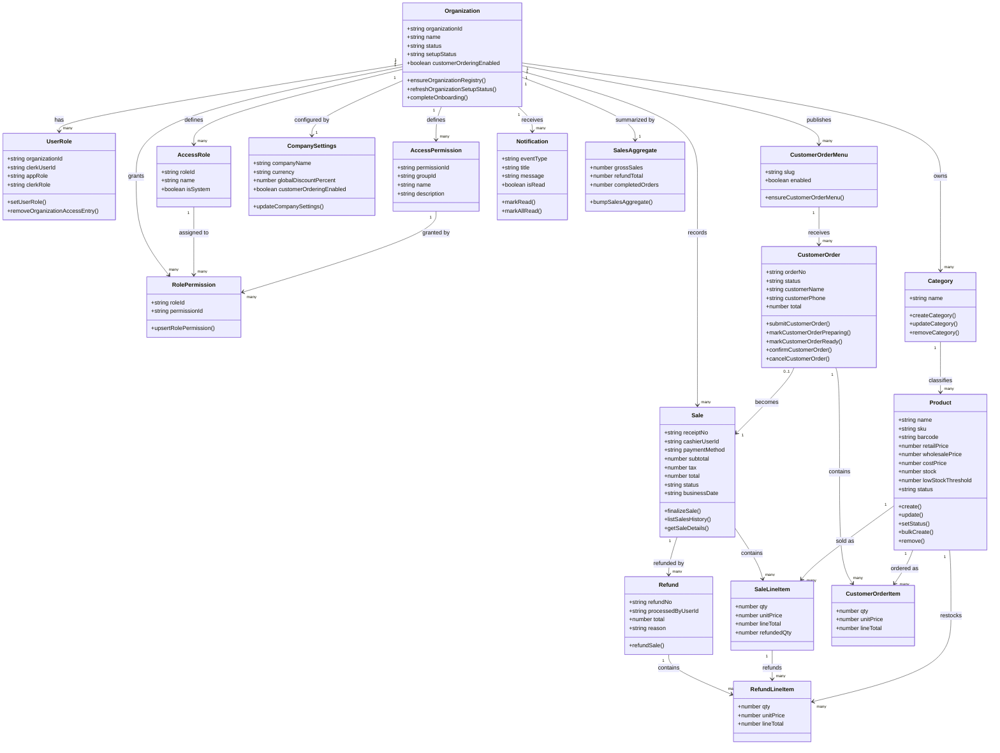

---

## 8. State Chart Diagrams

Product state is modeled as **two orthogonal axes**: a lifecycle axis (`active`/`inactive`, an explicit field) and a stock-level axis (derived from `stock` and `lowStockThreshold`, not a stored field). They are shown as two separate state machines rather than one composite diagram, since a product can independently be inactive-with-stock or active-out-of-stock.

### 8.1 Product Lifecycle State

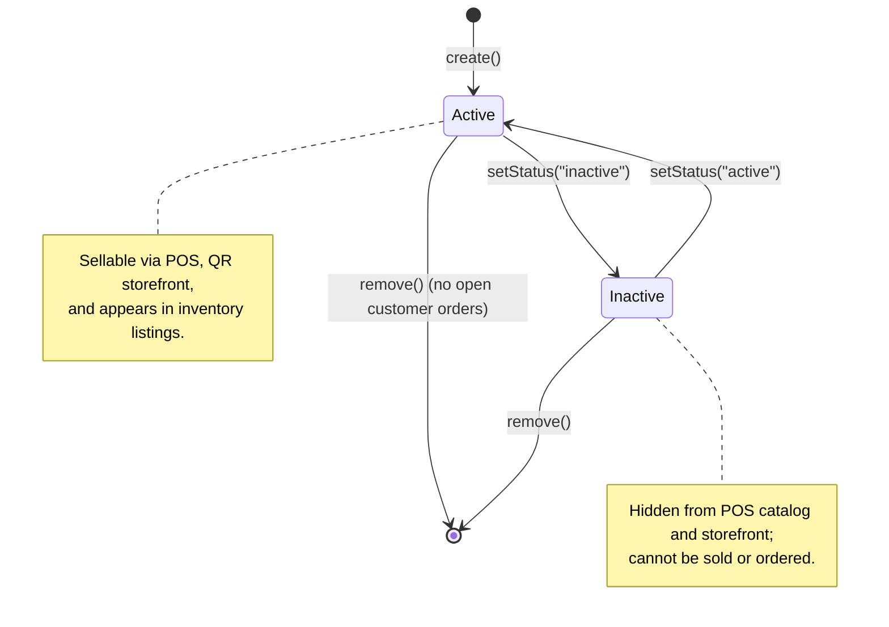

### 8.2 Product Stock-Level State

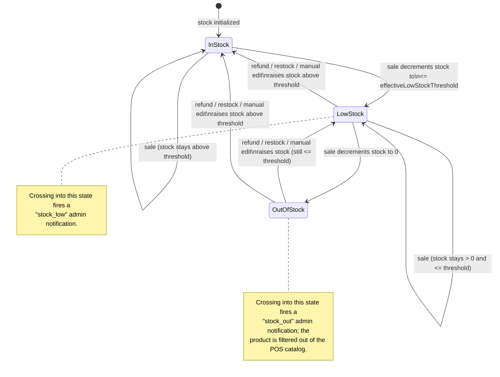

*Threshold logic (`convex/stock_thresholds.ts`): `effectiveLowStockThreshold` = the product's own `lowStockThreshold` if set, else a default of 10. A "critical" sub-state (`stock <= max(1, ceil(threshold × 0.6))`) is additionally flagged on the dashboard within `LowStock`.*

### 8.3 Customer Order State

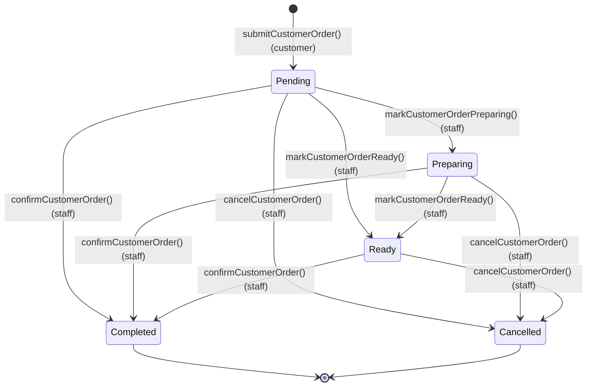

### 8.4 Sale State

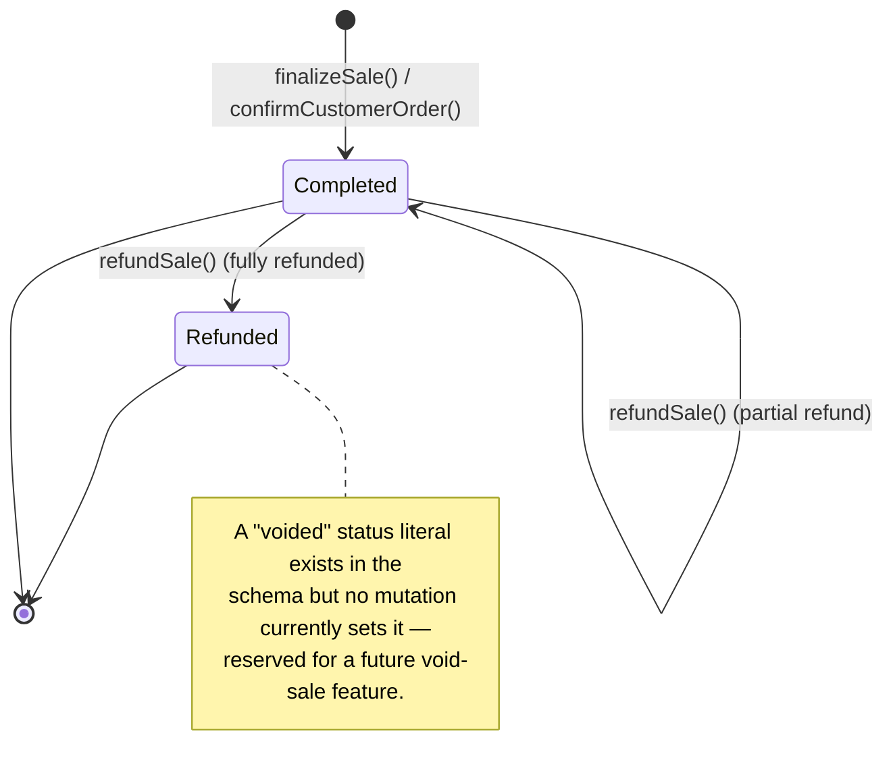

---

## 9. Sequence Diagrams

### 9.1 Completing a Sale (POS Checkout)

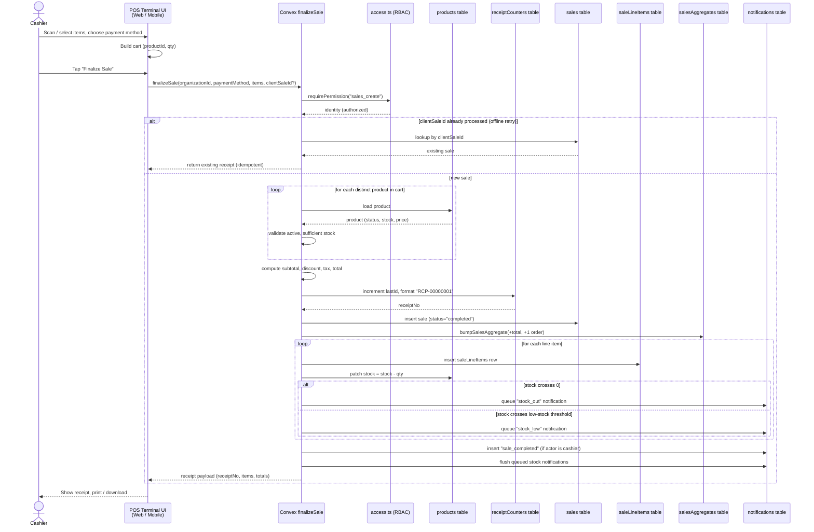

### 9.2 QR Customer Order — Placement & Confirmation

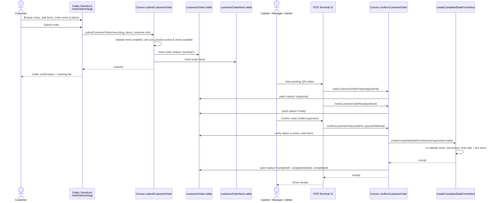

### 9.3 Refund Processing

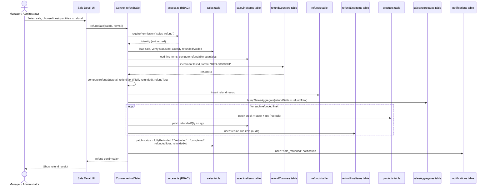

---

## 10. Communication Diagram — Sale Processing

> Mermaid has no native UML communication/collaboration diagram type. This is drawn as a flowchart with **numbered messages** on each edge — the standard workaround — representing the same interaction as §9.1 from an object-collaboration viewpoint rather than a time-ordered lifeline viewpoint.

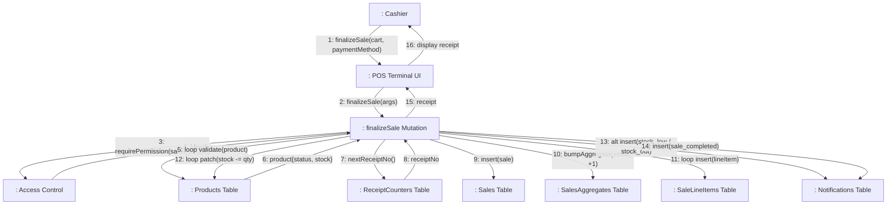

---

## 11. Activity Diagram — Sale & Inventory Update Flow

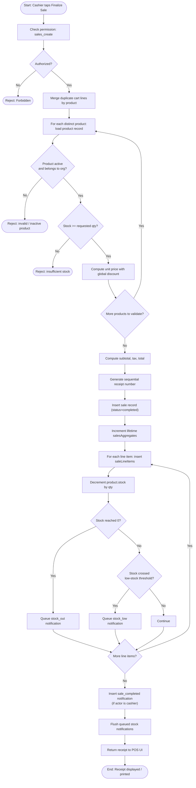

*The mirror-image flow for a refund reverses step A11 (`stock += qty` instead of `stock -= qty`) and never re-fires `stock_low`/`stock_out` notifications on restock — see §9.3.*

---

## 12. Access Control (RBAC) Model

### 12.1 Roles & Permission Matrix

Three fixed application roles exist as literals (`"administrator" | "manager" | "cashier"`), but **authorization never checks the role name directly** — every check resolves the caller's role, then looks up whether that role currently grants the requested permission in the `rolePermissions` table. This means the table below is the **default seed**, not a hardcoded rule; an administrator can customize any role's permissions per organization via `upsertRolePermission`.

| Permission ID | Description | Administrator | Manager | Cashier |
|---|:---|:---:|:---:|:---:|
| `sales_view` | View sales transactions | ✅ | ✅ | ✅ |
| `sales_create` | Process new sales | ✅ | ✅ | ✅ |
| `sales_refund` | Refund / restock completed sales | ✅ | ✅ | ❌ |
| `inventory_view` | View catalog / stock balances | ✅ | ✅ | ✅ |
| `inventory_manage` | Add / edit products | ✅ | ✅ | ❌ |
| `inventory_adjust` | Submit stock adjustments | ✅ | ✅ | ❌ |
| `employees_view` | View employee directory | ✅ | ✅ | ❌ |
| `employees_manage` | Add / update employees | ✅ | ✅ | ❌ |
| `reports_view` | View analytics / reports | ✅ | ✅ | ❌ |
| `reports_export` | Export CSV / PDF | ✅ | ✅ | ❌ |
| `settings_company` | Edit company profile | ✅ | ✅ | ❌ |
| `settings_users` | Manage users & role-permission templates | ✅ | ❌ | ❌ |

### 12.2 Authorization Enforcement Pattern

There is **no decorator or middleware layer** — every Convex query/mutation calls an explicit check as the **first statement** of its handler:

```ts
handler: async (ctx, args) => {
  const identity = await requirePermission(ctx, args.organizationId, "sales_create", {
    allowBootstrap: true,
  });
  // ...rest of handler
}
```

**Membership** = the caller's active Clerk-org JWT claim matches the target `organizationId`, **or** a `userRoles` row exists for that `(organizationId, clerkUserId)` pair.

**Permission** = the caller's `userRoles.appRole` has a matching grant row in `rolePermissions` for `(organizationId, roleId, permissionId)`.

**Bootstrap escape hatch**: a Clerk org admin/owner acting on their **own** organization is let through *only while that organization has zero `userRoles` rows* (i.e. a brand-new org, before any app-level role has ever been assigned). The instant any `userRoles` row exists for the org, this path closes permanently — Convex's own RBAC tables become the sole source of truth, so even a demoted Clerk admin loses access if their app role is revoked. Clerk's org role is deliberately **not** trusted as an ongoing authorization signal, only as a one-time setup convenience.

---

## 13. Appendix A — Convex Backend Module Reference

| Module | Responsibility |
|---|---|
| `schema.ts` | Full database schema definition (24 tables) |
| `access.ts` | Core RBAC primitives — membership/permission checks, bootstrap logic |
| `rbac.ts` | Role/permission/invite management API (`setUserRole`, `upsertRolePermission`, `seedOrganizationAccess`, …) |
| `auth.config.ts` | Registers Clerk as Convex's JWT auth provider |
| `organizations.ts` | Org registry lifecycle, onboarding status |
| `products.ts` | Product/category catalog CRUD, bulk import |
| `sales.ts` | POS transaction engine + public customer-ordering storefront (`finalizeSale`, `confirmCustomerOrder`, `refundSale`, `submitCustomerOrder`, …) |
| `reporting.ts` | Shared reporting math/helpers (not user-facing endpoints) |
| `reports_sales.ts` / `reports_inventory.ts` | Sales and inventory report queries |
| `analytics.ts` | Dashboard analytics (stock velocity, inventory risk/health) |
| `dashboard.ts` | Dashboard snapshot, weekly pulse, alerts, `salesAggregates` reconciliation |
| `global_search.ts` | Cross-entity command-palette search |
| `notifications.ts` / `notification_helpers.ts` | In-app notification feed and admin-recipient helpers |
| `push_notifications.ts` | Native push token lifecycle and delivery via Expo/FCM |
| `settings.ts` | Company and personal settings |
| `stock_thresholds.ts` | Low-stock / critical-stock threshold math |
| `business_date.ts` | Timezone-aware "business day" bucketing |
| `crons.ts` | Scheduled jobs (daily notification purge) |
| `migrations.ts` | One-off data migrations |
| `posthog.ts` / `convex.config.ts` | Server-side PostHog error reporting and component registration |

---

## 14. Appendix B — Glossary

| Term | Definition |
|---|---|
| **Convex** | A backend-as-a-service providing a reactive document database and serverless TypeScript functions; the sole backend for both MansaStock clients. |
| **Clerk** | The third-party identity provider handling authentication and multi-tenant Organizations. |
| **Organization (tenant)** | A single MansaStock business/store; the primary partition key (`organizationId`) across nearly every database table. |
| **TWA (Trusted Web Activity)** | An Android technology that lets a web app be installed and distributed through Google Play with no browser UI; used here to wrap the web POS. |
| **RBAC** | Role-Based Access Control — MansaStock's authorization model, driven by data (`rolePermissions`) rather than hardcoded role checks. |
| **OCC (Optimistic Concurrency Control)** | Convex's default transaction isolation model; conflicting concurrent writes are retried rather than locked. |
| **SKU** | Stock-Keeping Unit — the internal product code; distinct from `barcode`, the physical scan code. |
| **POS** | Point of Sale — the checkout terminal used by staff to process sales. |
| **ERD** | Entity-Relationship Diagram. |
| **DFD** | Data Flow Diagram. |
| **Business date** | A timezone-aware "trading day" bucket used for daily reporting, so a store's "today" aligns with its local close-of-day rather than UTC midnight. |
